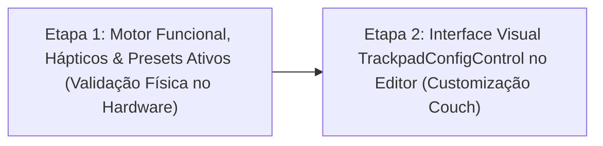

# Plano de Implementação — Configuração dos Trackpads do Steam Deck

> **Documento de Arquitetura Técnica e Roteiro de Fases Testáveis**  
> Especificação do motor de emulação, processamento analógico de toque/clique mecânico, feedback háptico e interface de customização dos Trackpads Esquerdo e Direito do Steam Deck.  
> 
> **Documentos Relacionados:**
> - [Plano de Implementação do Modo Desktop](PLANO_DE_IMPLEMENTACAO_MODO_DESKTOP.md)
> - [Regras e Diretrizes do Projeto](REGRAS_DO_PROJETO.md)
> - [Plano de Suporte ao Steam Deck](PLANO_DE_IMPLEMENTACAO_STEAMDECK.md)
> - [Plano do Sistema de Perfis](PLANO_DE_IMPLEMENTACAO_PROFILES.md)

---

## 1. Visão Geral, Necessidade & Solução Proposta

### 1.1. A Necessidade
O **Steam Deck** possui dois trackpads táteis com sensores analógicos de alta resolução (`16-bit`), detecção capacitiva de toque (`Touch`), clique físico mecânico (`Press`) e atuadores lineares de feedback háptico (`Haptics`).  
Atualmente no projeto:
* O [`SteamDeckService`](file:///C:/PROJETOS/ConsoleMode-GamepadCompanion/src/ConsoleMode.GamepadCompanion/Hardware/SteamDeckService.cs) já realiza a leitura em tempo real dos relatórios HID brutos (`LPadX`, `LPadY`, `IsLPadTouch`, `IsLPadPress`, `RPadX`, `RPadY`, `IsRPadTouch`, `IsRPadPress`).
* O [`GamepadVisualDebugger`](file:///C:/PROJETOS/ConsoleMode-GamepadCompanion/src/ConsoleMode.GamepadCompanion/UI/Controls/GamepadVisualDebugger.cs) já renderiza esses dados brutos ao vivo.
* **Porém**, o motor de mapeamento ainda não processa nem emula entradas baseadas nos trackpads, e o [`GameProfileEditorControl`](file:///C:/PROJETOS/ConsoleMode-GamepadCompanion/src/ConsoleMode.GamepadCompanion/UI/Controls/GameProfileEditorControl.cs) exibe apenas cards visuais com o rótulo de placeholder `(Planejada - Fase 6)`.

Sem essa funcionalidade, o jogador não consegue utilizar os trackpads para mira de precisão em jogos de tiro/estratégia, rolagem confortável de páginas no [Modo Desktop](PLANO_DE_IMPLEMENTACAO_MODO_DESKTOP.md) ou atalhos direcionais adicionais.

### 1.2. A Solução Proposta
Implementar uma arquitetura desacoplada e testável para os Trackpads, permitindo que cada trackpad (Esquerdo e Direito) opere individualmente em um dos modos funcionais essenciais:
1. **Mouse / Trackball de Alta Precisão**: Movimento relativo do cursor com sensibilidade, aceleração linear, filtro anti-jitter e inércia simulada ao soltar o dedo em velocidade.
2. **Scrollwheel (Roda do Mouse)**: Deslize contínuo para rolagem vertical e horizontal, com **rolagem natural invertida ativada por padrão** (deslizar o dedo para cima desce a página e vice-versa).
3. **D-Pad / Botões Direcionais**: Mapeamento de 4 quadrantes direcionais (Cima, Baixo, Esquerda, Direita) com **Deadzone Central de 15%** para descanso seguro do polegar.
4. **Botão Único (Single Button)**: A superfície atua como um botão mecânico extra para atalhos do sistema, macros ou Push-to-Talk.
5. **Arquitetura de Dupla Ação (`Touch` independente de `Press`)**: Suporte a configurar ações distintas para o toque suave (`Touch`) e para afundar o clique mecânico (`Press`) ou atingir limiar de pressão analógica (*Force Touch* com histerese).
6. **Feedback Háptico Refinado**: Driver nativo Neptune via pacotes `0xEA` (`SDCHapticPacket2`), emitindo micro-pulsos táteis ao rolar a trackball, ticks de catraca ao rolar páginas e clique tátil ao afundar a pressão analógica.
7. **Navegação Universal no Companion UI**: Quando o aplicativo Companion estiver em primeiro plano, os trackpads permanecem ativados por padrão (Direito = Mouse + Clique, Esquerdo = Rolagem Vertical), permitindo apontar, clicar e rolar livremente pelo app sem conflitar com a navegação nativa do controle via D-Pad.
8. **Física e Estabilização SteamOS / macOS (Anti-Squash & Gesto de Inércia)**: Supressão de deslocamentos parasitas gerados pelo achatamento do polegar durante o clique e ativação de inércia restrita a gestos com distância de varredura real, prevenindo estilingadas acidentais.

> [!NOTE]
> **Decisão de Escopo — Menu Radial:**
> O conceito de **Menu Radial Translúcido em Overlay** (menus circulares com fatias de atalhos ativados no toque) foi aprovado arquiteturalmente, mas **postergado para o TODO futuro do projeto**, mantendo este plano estritamente focado nos modos fundamentais de entrada e feedback háptico.

---

## 2. Decisões Arquiteturais & Diretrizes de Engenharia

Para manter conformidade estrita com as [Regras do Projeto](REGRAS_DO_PROJETO.md), esta implementação obedece aos seguintes pilares:

1. **Reaproveitamento de Código (Princípio DRY):**
   - Não criar novos seletores de teclas do zero. Para ações de clique, D-Pad e Botão Único dos trackpads, reaproveitar integralmente o [`InputBindingCaptureControl`](file:///C:/PROJETOS/ConsoleMode-GamepadCompanion/src/ConsoleMode.GamepadCompanion/UI/Controls/InputBindingCaptureControl.cs) e o [`InputVisualSelectorControl`](file:///C:/PROJETOS/ConsoleMode-GamepadCompanion/src/ConsoleMode.GamepadCompanion/UI/Controls/InputVisualSelectorControl.cs).
2. **Identidade Visual Dark Mode OLED:**
   - Estilo visual consistente com o resto do aplicativo: fundo escuro `#12131A`, cartões `#1E2029`, destaques ciano `#38BDF8` e verde esmeralda `#10B981`, tipografia Segoe UI e navegação com foco dourado `#F59E0B`. Zero uso de controles cinza padrão do Windows Forms.
3. **Ocultação Inteligente em Dispositivos Sem Trackpad:**
   - Os cards de Trackpad no editor de perfil só são exibidos quando `SteamDeckDetector.Current.IsSteamDeck` for verdadeiro. Em PCs padrão ou outros handhelds que possuem botões traseiros mas não têm trackpads (como ROG Ally), os cards permanecem ocultos, mantendo a interface limpa e livre de ruído.
4. **Desacoplamento e Testabilidade (Regra 1):**
   - O processador matemático dos trackpads (`TrackpadProcessor`) opera puramente sobre estruturas numéricas e deltas de tempo (`dt`), sem depender de chamadas Win32 estáticas ou do hardware USB. Isso viabiliza testes unitários automatizados cobrindo aceleração, inércia, zonas mortas e haptics em qualquer ambiente de CI/build.

---

## 3. Roteiro Consolidado em 2 Etapas Práticas

A implementação é estruturada em **2 etapas diretas e testáveis**: primeiro entrega-se o motor funcional completo com feedback háptico e presets para teste imediato no hardware; em seguida, entrega-se o painel visual de customização.

---

### ETAPA 1: Motor Funcional, Hápticos & Presets de Fábrica (Validação Imediata)
* **Objetivo:** Construir toda a inteligência matemática, o modelo de domínio, a persistência, o disparo de hápticos e ativar os presets de fábrica para que o usuário possa testar os trackpads imediatamente no Steam Deck.
* **Tarefas:**
  1. **Modelo de Domínio & Persistência:**
     - Enums: `TrackpadMode` (`Disabled`, `MouseTrackball`, `Scrollwheel`, `DPad`, `SingleButton`), `TrackpadHapticIntensity` (`Off`, `Low`, `Medium`, `High`).
     - Estrutura `TrackpadConfig` com suporte a Dupla Ação:
       - `TouchActions` (disparo ao encostar).
       - `PressActions` (disparo ao afundar o clique mecânico).
       - Sliders de sensibilidade (1..100), atrito/inércia, flag `InvertScroll` (padrão: `true`).
     - Serialização retrocompatível em `config.ini` sob `[DesktopProfile]` e em `games.ini`.
  2. **Motor Matemático (`TrackpadProcessor`):**
     - **Central de Variáveis de Calibração (`TrackpadTuning`)**: Concentração de todas as constantes e coeficientes de calibração no topo da classe para facilitar fine-tuning iterativo sem dispersão de valores fixos no código.
     - **Mouse / Trackball**: Conversão de coordenadas em deltas relativos `(dx, dy)`, filtro anti-jitter capacitivo (`DeadzoneThreshold = 20f`), suavização EMA dinâmica (`alpha = 0.40f` inicial para precisão em abas e botões pequenos).
     - **Estabilização de Mira Anti-Squash (Padrão SteamOS / macOS)**: Detecção da subida de pressão analógica (`rawPressure >= 8500`) e clique efetivo (`isEffectivePress`), atenuando em 90% (`ClickStabilizationDamping = 0.10f`) os deslocamentos do cursor causados pelo amassamento da polpa do polegar contra a superfície capacitiva no momento de clicar.
     - **Âncora Magnética de Duplo Clique (Valve Click Lock)**: Travamento rígido em 0px durante 500ms (`DoubleClickLockDuration = 0.50f`) com quebra por arrasto intencional (`DoubleClickBreakDistance = 200f`), garantindo 100% de taxa de acerto em duplos cliques no Windows sem perder o Click & Drag.
     - **Inércia Inteligente por Trajeto de Gesto (`Stroke Distance`)**: A inércia da trackball só é armada quando o gesto cobre uma distância cumulativa real no pad (`_strokeDistanceAccumulator >= 1600f`, `MinTouchFramesForInertia = 2`) associada a uma velocidade mínima de decolagem (`MinFlickSpeed = 180f`). Movimentos curtos, toques de 1 frame e paradas na deadzone antes da soltura nunca disparam inércia residual ("efeito estilingue").
     - **Desativação Completa do Lizard Mode & Supressão do Watchdog Neptune (Protocolo Oficial Linux/Valve)**: Envio do pacote oficial `0x87` com desativação explícita de mouse/scroll em ambos os pads (`SETTING_LEFT_TRACKPAD_MODE = 7`, `SETTING_RIGHT_TRACKPAD_MODE = 7`) e desativação do watchdog de firmware (`SETTING_STEAM_WATCHDOG_ENABLE = 0x46 -> 0`) associado a keepalive periódico a cada 1s. Isso impede definitivamente que o firmware interno do Steam Deck reverta silenciosamente em hardware para o Lizard Mode após alguns segundos, eliminando a injeção concorrente de scroll supersônico do firmware em paralelo com o Companion.
     - **Scrollwheel com Consumo Integral, Inversão Instantânea e Rate Limiting Mecânico**: Deslocamento vertical contínuo com rolagem natural invertida padrão e passo calibrado para a escala de alta resolução do Deck (`ScrollStep = 8000f`). Consumo integral do acumulador a cada notch emitido (sem estocagem residual de notches futuros que causavam efeito metralhadora após solavancos), inversão instantânea de acúmulo na mudança de sentido, resposta contínua linear em baixa velocidade sem deadbands artificiais, filtro anti-salto capacitivo (`MaxPhysicalDeltaPerFrame = 6000f`) e cooldown mecânico entre notches (`ScrollMinIntervalSeconds = 0.080f` ~ 12 notches/s), eliminando a ativação involuntária da aceleração supersônica (*momentum scroll*) do Chrome e do Windows Explorer.
     - **D-Pad**: Cálculo de quadrantes angulares com **Deadzone Central de 15%**.
     - **Botão Único**: Disparo independente por Toque e/ou Clique mecânico/pressão analógica.
  3. **Feedback Háptico (`SteamDeckHaptics`):**
     - Integração com o [`SteamDeckService`](file:///C:/PROJETOS/ConsoleMode-GamepadCompanion/src/ConsoleMode.GamepadCompanion/Hardware/SteamDeckService.cs) via relatórios de feature HID.
     - Pulsos de catraca a cada linha de rolagem no Scrollwheel.
     - Pulsos táteis suaves proporcionais à rotação da trackball.
     - Padrão ativado em **`Suave (Low)`**.
  4. **Ativação dos Presets de Fábrica:**
     - **[Modo Desktop](PLANO_DE_IMPLEMENTACAO_MODO_DESKTOP.md)**:
       - Trackpad Direito = Mouse/Trackball com clique mecânico emitindo Clique Esquerdo do Mouse.
       - Trackpad Esquerdo = Scrollwheel vertical contínuo com rolagem natural e haptics.
     - **Jogos (`Standard PC` / `RPG`)**: Trackpad Direito como mira/câmera suave de precisão.
* **Critério de Aceite da Etapa 1:**
  - O usuário executa o app no Steam Deck e já consegue mover o mouse suavemente pelo Trackpad Direito e rolar páginas na web pelo Trackpad Esquerdo com sensação tátil de catraca na mão.
  - Suíte de testes unitários cobrindo todos os cálculos matemáticos com 100% de sucesso.

---

### ETAPA 2: Interface Visual de Customização no Editor (`TrackpadConfigControl`)
* **Objetivo:** Permitir ao usuário personalizar modos, sensibilidade, deadzones, haptics e botões dos trackpads diretamente pela TV ou tela do Steam Deck via controle.
* **Tarefas:**
  1. **Ocultação Contextual de Hardware:**
     - No [`GameProfileEditorControl`](file:///C:/PROJETOS/ConsoleMode-GamepadCompanion/src/ConsoleMode.GamepadCompanion/UI/Controls/GameProfileEditorControl.cs), os cards `TRACKPAD ESQUERDO` e `TRACKPAD DIREITO` só são visíveis se `SteamDeckDetector.Current.IsSteamDeck == true`.
  2. **Sub-painel Dedicado `TrackpadConfigControl`:**
     - Layout Couch Gaming 100% Dark Mode OLED.
     - Navegação por D-Pad e confirmação com `[A]`.
     - Seletor de Modo (`Mouse`, `Scroll`, `D-Pad`, `Botão Único`, `Desativado`).
     - Sliders contextuais: Sensibilidade, Inércia, Intensidade Háptica (`Desligado`, `Suave`, `Médio`, `Forte`), Deadzone Central e Inversão de Scroll.
     - Mapeamento de ações de Toque e Clique mecânico reutilizando 100% DRY o [`InputBindingCaptureControl`](file:///C:/PROJETOS/ConsoleMode-GamepadCompanion/src/ConsoleMode.GamepadCompanion/UI/Controls/InputBindingCaptureControl.cs).
     - Tecla `[B]` para fechar e retornar ao diagrama geral.
* **Critério de Aceite da Etapa 2:**
  - O usuário consegue abrir a configuração de qualquer trackpad, mudar o modo (ex: transformar o trackpad esquerdo em D-Pad de atalhos), salvar com `[RT]` e testar a mudança imediatamente.
  - Testes automatizados de UI e 0 avisos de build.

---

## 4. Critérios de Aceite Globais

1. O usuário no Steam Deck desliza o polegar no Trackpad Direito e movimenta o cursor do mouse com precisão, aceleração e inércia no Windows e jogos.
2. O Trackpad Esquerdo rola páginas da web e documentos no Windows de forma contínua e natural com feedback tátil no dedo.
3. As personalizações feitas no editor visual persistem no `config.ini` e `games.ini`.
4. Dispositivos comuns de PC e outros handhelds sem trackpad mantêm os cards ocultos de forma limpa e transparente.
5. Todos os testes unitários da suíte continuam passando com 100% de sucesso e 0 avisos no build.

---

## 5. Diagnóstico e Resolução: Lizard Mode Watchdog e Haptics LRA (Hardware Neptune)

### 1. Causa Raiz do Lizard Mode Rearmando Sozinho
- **Hardware Watchdog:** O firmware do Steam Deck (chip Neptune) possui um watchdog de hardware que restaura o modo de compatibilidade de mouse/teclado de emergência se o host não enviar sinais de controle periodicamente.
- **Solução:** Reintrodução de um keepalive periódico a cada 1000ms (`LizardModeKeepaliveIntervalMs`) no loop de polling `PollLoop()`. Utiliza a classe de alta performance `SteamDeckHidNative` para envio direto via `hid_send_feature_report`, completando em menos de 0.1ms sem bloquear o thread de captura nem introduzir jitter nos pacotes analógicos.

### 2. Causa Raiz da Falha dos Haptics (Atuadores LRA Silenciosos)
- **Incompatibilidade do Wrapper HidApi:** O método gerenciado `HidDevice.RequestFeatureReport` chamava `hid_get_feature_report` logo após enviar os dados. Como o firmware do Steam Deck não responde a requisições de GET para comandos de saída/rumble, ele lançava uma exceção silenciosa e bloqueava a execução.
- **Erro de Indexação de Atuador:** O protocolo nativo de haptics da Valve (`0xEA` - `MsgTriggerHaptic`) define os atuadores por bits/máscara (`0x01` para o trackpad esquerdo e `0x02` para o direito). O código anterior utilizava índice zero para a esquerda (`0`), o qual era ignorado pelo firmware.
- **Solução:** Implementação de `SteamDeckHidNative` com delegate nativo direto para `hid_send_feature_report`. Envio simultâneo dos relatórios oficiais de 65 bytes: `0xEA` (Deck-specific com parâmetros de clique nítido, ganho em dB e duração) e `0x8F` (`ID_TRIGGER_HAPTIC_PULSE` universal), garantindo acionamento físico imediato dos motores LRA tanto em cliques quanto em rotação/scroll.
