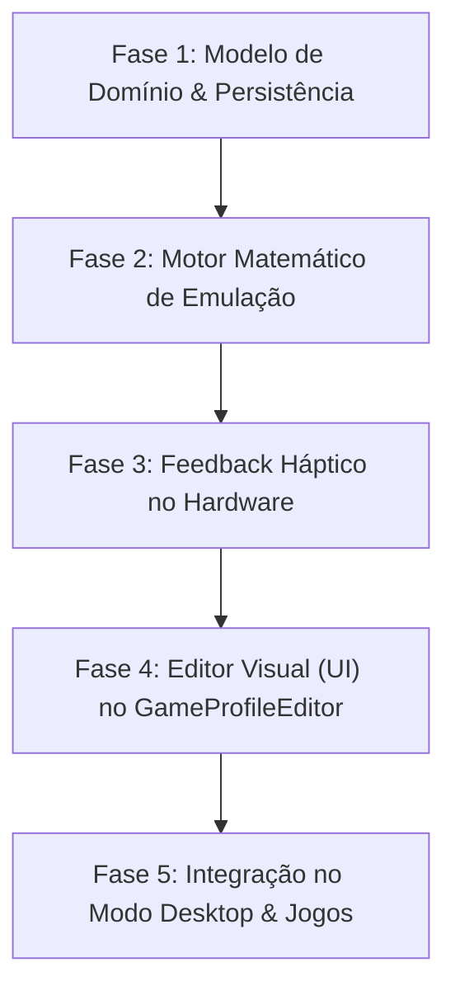

# Plano de Implementação — Configuração dos Trackpads do Steam Deck

> **Documento de Arquitetura Técnica e Roteiro de Fases Testáveis**  
> Especificação para o motor de emulação, processamento de toque/clique físico, feedback háptico e interface de customização dos Trackpads Esquerdo e Direito do Steam Deck.  
> 
> **Documentos Relacionados:**
> - [Plano de Implementação do Modo Desktop](PLANO_DE_IMPLEMENTACAO_MODO_DESKTOP.md)
> - [Regras e Diretrizes do Projeto](REGRAS_DO_PROJETO.md)
> - [Plano de Suporte ao Steam Deck](PLANO_DE_IMPLEMENTACAO_STEAMDECK.md)
> - [Plano do Sistema de Perfis](PLANO_DE_IMPLEMENTACAO_PROFILES.md)

---

## 1. Visão Geral, Necessidade & Solução Proposta

### 1.1. A Necessidade
O **Steam Deck** possui dois trackpads táteis com sensores de coordenadas analógicas de alta resolução (`16-bit`), detecção de toque (`Touch`), clique físico mecânico (`Press`) e atuadores lineares de feedback háptico (`Haptics`).  
Atualmente no projeto:
* O [`SteamDeckService`](file:///C:/PROJETOS/ConsoleMode-GamepadCompanion/src/ConsoleMode.GamepadCompanion/Hardware/SteamDeckService.cs) já realiza a leitura dos relatórios HID brutos e disponibiliza `LPadX`, `LPadY`, `IsLPadTouch`, `IsLPadPress`, `RPadX`, `RPadY`, `IsRPadTouch` e `IsRPadPress`.
* O [`GamepadVisualDebugger`](file:///C:/PROJETOS/ConsoleMode-GamepadCompanion/src/ConsoleMode.GamepadCompanion/UI/Controls/GamepadVisualDebugger.cs) já renderiza o feedback visual desses dados brutos em tempo real.
* **Porém**, o motor de mapeamento de perfis ainda não processa nem emula entradas baseadas nos trackpads, e o [`GameProfileEditorControl`](file:///C:/PROJETOS/ConsoleMode-GamepadCompanion/src/ConsoleMode.GamepadCompanion/UI/Controls/GameProfileEditorControl.cs) exibe apenas cards visuais com o rótulo de placeholder `(Planejada - Fase 6)`.

Sem essa funcionalidade, o jogador não consegue utilizar os trackpads para mira de precisão em jogos de tiro/estratégia, rolagem confortável de páginas no [Modo Desktop](PLANO_DE_IMPLEMENTACAO_MODO_DESKTOP.md) ou atalhos direcionais adicionais.

### 1.2. A Solução Proposta
Implementar uma arquitetura modular e testável para os Trackpads, desacoplada do hardware físico via interfaces, permitindo que cada trackpad (Esquerdo e Direito) seja configurado individualmente em um dos modos funcionais essenciais:
1. **Mouse / Trackball de Alta Precisão**: Movimento relativo do cursor com sensibilidade, aceleração linear e inércia simulada ao soltar o dedo em movimento rápido.
2. **Scrollwheel (Roda do Mouse)**: Deslize contínuo para rolagem vertical e horizontal de páginas web, inventários de RPG e documentos.
3. **D-Pad / Botões Direcionais**: Mapeamento de 4 quadrantes direcionais (Cima, Baixo, Esquerda, Direita) por toque ou clique físico.
4. **Botão Único (Single Button)**: A superfície atua como um botão mecânico extra para atalhos do sistema, macros ou Push-to-Talk.

> [!NOTE]
> **Decisão de Escopo — Menu Radial:**
> O conceito de **Menu Radial Translúcido em Overlay** (menus circulares com fatias de atalhos ativados no toque) foi aprovado arquiteturalmente, mas **postergado para o TODO futuro do projeto**, mantendo este plano estritamente focado nos modos fundamentais de entrada e feedback háptico.

---

## 2. Decisões Arquiteturais & Diretrizes de Engenharia

Para manter conformidade estrita com as [Regras do Projeto](REGRAS_DO_PROJETO.md), esta implementação obedece aos seguintes pilares:

1. **Reaproveitamento de Código (Princípio DRY):**
   - Não criar novos seletores de teclas do zero. Para ações de clique, D-Pad e Botão Único dos trackpads, reaproveitar integralmente o [`InputBindingCaptureControl`](file:///C:/PROJETOS/ConsoleMode-GamepadCompanion/src/ConsoleMode.GamepadCompanion/UI/Controls/InputBindingCaptureControl.cs) e o [`InputVisualSelectorControl`](file:///C:/PROJETOS/ConsoleMode-GamepadCompanion/src/ConsoleMode.GamepadCompanion/UI/Controls/InputVisualSelectorControl.cs).
2. **Identidade Visual Dark Mode OLED:**
   - Estilo visual consistente com o resto do aplicativo: fundo escuro `#12131A`, cartões `#1E2029`, destaques ciano `#38BDF8` e verde esmeralda `#10B981`, tipografia Segoe UI e navegação com foco dourado `#F59E0B`. Zero uso de controles cinza padrão do Windows Forms.
3. **Desacoplamento e Testabilidade (Regra 1):**
   - O processador matemático dos trackpads (`TrackpadProcessor`) opera puramente sobre estruturas numéricas e deltas de tempo (`dt`), sem depender de chamadas Win32 estáticas ou do hardware USB. Isso viabiliza testes unitários automatizados cobrindo aceleração, inércia, zonas mortas e haptics em qualquer ambiente de CI/build.
4. **Não-Bloqueio e Alta Performance:**
   - Processamento de toque e pulsos hápticos em threads assíncronas de polling sem congelar o loop de renderização da UI ou do jogo.

---

## 3. Roteiro de Fases de Execução Testáveis

---

### FASE 1: Modelo de Domínio, Configurações & Persistência
* **Objetivo:** Definir as estruturas de dados no modelo de domínio e integrá-las à serialização do `GameProfile` nos perfis de jogos e no perfil Desktop.
* **Tarefas:**
  1. Criar enums e modelos de configuração:
     - `TrackpadMode`: `Disabled`, `MouseTrackball`, `Scrollwheel`, `DPad`, `SingleButton`.
     - `TrackpadHapticIntensity`: `Off`, `Low`, `Medium`, `High`.
     - `TrackpadClickTrigger`: `OnClick`, `OnTouch`.
     - `TrackpadConfig`: Armazena o modo, sensibilidade (1..100), aceleração, atrito/inércia, mapeamento de cliques e quadrantes.
  2. Integrar `LeftTrackpad` e `RightTrackpad` na classe `GameProfilePage`.
  3. Atualizar a serialização/deserialização em `ProfileSerializer.cs` mantendo compatibilidade retroativa com arquivos `.ini` legados.
* **Entregável Testável:** Testes unitários validando serialização, valores default e clonagem de instâncias com 100% de cobertura.

---

### FASE 2: Motor de Emulação de Entrada (`TrackpadProcessor`)
* **Objetivo:** Processar coordenadas brutas `(X, Y)` e disparar eventos de mouse, scroll ou teclas de forma suave e ergonômica.
* **Tarefas:**
  1. **Algoritmo de Mouse / Trackball:**
     - Conversão de coordenadas absolutas em deltas relativos `(dx, dy)`.
     - Filtro passa-baixas para eliminar ruído de tremulação do dedo (*jitter filter*).
     - Curva de aceleração configurável.
     - Simulação de inércia física (quando o dedo se descola do pad com velocidade residual, o cursor continua desacelerando gradualmente).
  2. **Algoritmo de Scrollwheel:**
     - Conversão de deslocamento vertical em eventos `MouseWheel(delta)` fracionários acumulados.
  3. **Algoritmo de D-Pad / Quadrantes:**
     - Cálculo angular via `Math.Atan2(y, x)` com zona morta central configurável, emitindo as ações registradas para Cima, Baixo, Esquerda e Direita.
  4. **Algoritmo de Botão Único:**
     - Disparo da ação configurada ao pressionar o clique mecânico do pad ou ao encostar o dedo.
* **Entregável Testável:** Suíte de testes unitários injetando séries temporais de coordenadas sintéticas e conferindo os eventos exatos recebidos pelo `IInputSimulator`.

---

### FASE 3: Feedback Háptico do Steam Deck (`SteamDeckHaptics`)
* **Objetivo:** Fornecer retorno tátil tátil linear nos pads para confirmar deslocamentos e cliques.
* **Tarefas:**
  1. Implementar o envio de comandos de haptics no `SteamDeckService` através dos feature reports HID suportados pelo controlador Jupiter/Galileo.
  2. Emitir "micro-pulsos" durante a movimentação da trackball proporcionais à velocidade do giro.
  3. Emitir "ticks de catraca" a cada dente de rolagem no modo Scrollwheel.
  4. Emitir pulsos de confirmação ao cruzar quadrantes no modo D-Pad.
* **Entregável Testável:** Mocks e testes unitários verificando emissão correta de pulsos e respeito ao slider de intensidade (`Off`, `Low`, `Medium`, `High`).

---

### FASE 4: Editor Visual de Trackpads (`TrackpadConfigControl`)
* **Objetivo:** Permitir ao usuário personalizar os trackpads diretamente pela interface Couch Gaming do Companion sem usar teclado ou mouse físico.
* **Tarefas:**
  1. Transformar os cartões de placeholder em `GameProfileEditorControl` em controles interativos acessíveis via navegação por D-Pad.
  2. Abrir o sub-painel `TrackpadConfigControl`:
     - Seleção do Modo (`Mouse`, `Scroll`, `D-Pad`, `Botão Único`).
     - Sliders de Sensibilidade e Intensidade Háptica.
     - Mapeamento das ações dos quadrantes/cliques reutilizando o [`InputBindingCaptureControl`](file:///C:/PROJETOS/ConsoleMode-GamepadCompanion/src/ConsoleMode.GamepadCompanion/UI/Controls/InputBindingCaptureControl.cs).
  3. Suporte completo a cancelamento com `[B]`, confirmação com `[A]` e navegação por D-Pad.
* **Entregável Testável:** Testes de integração de UI validando a abertura, alteração de valores e persistência dos dados salvos no editor.

---

### FASE 5: Presets & Integração no Modo Desktop
* **Objetivo:** Fornecer configurações padrão altamente ergonômicas para uso imediato no sistema.
* **Tarefas:**
  1. Configurar o preset padrão do [Modo Desktop](PLANO_DE_IMPLEMENTACAO_MODO_DESKTOP.md):
     - **Trackpad Direito**: Mouse de precisão com aceleração suave + Clique mecânico = Clique Esquerdo do Mouse.
     - **Trackpad Esquerdo**: Scrollwheel vertical contínuo com feedback háptico sutil.
  2. Configurar o preset padrão de Jogos (`Standard PC` e `RPG`):
     - Trackpad direito configurado como mouse de câmera/mira de apoio.
* **Entregável Testável:** Testes validando que novos perfis criados contêm a configuração ergonômica padrão.

---

## 4. Critérios de Aceite Globais

1. O usuário no Steam Deck consegue deslizar o polegar no Trackpad Direito e movimentar o cursor do mouse com precisão e suavidade no Windows e em jogos.
2. O Trackpad Esquerdo permite rolar páginas da web e documentos no Windows de forma contínua e natural com feedback tátil no dedo.
3. As alterações de configuração do trackpad feitas pelo editor visual são salvas e persistidas no `config.ini` / `games.ini`.
4. Dispositivos comuns que não são Steam Deck mantêm os trackpads desativados de forma transparente, sem causar travamentos ou erros.
5. Todos os testes unitários da suíte continuam passando com 100% de sucesso e 0 avisos no build.
